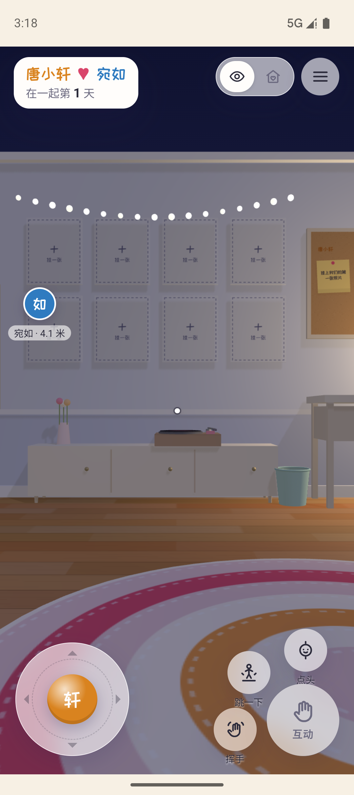
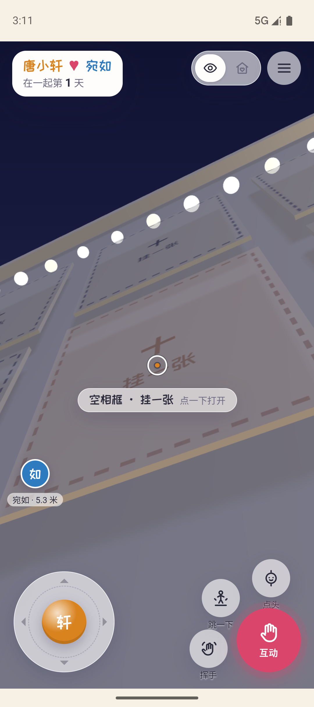
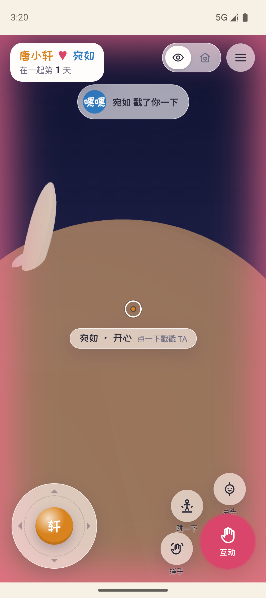
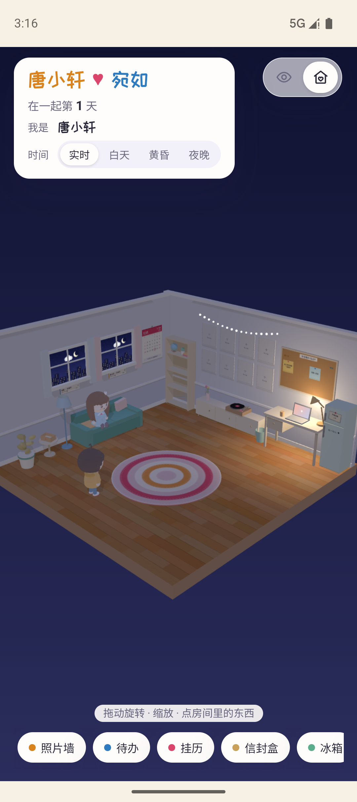
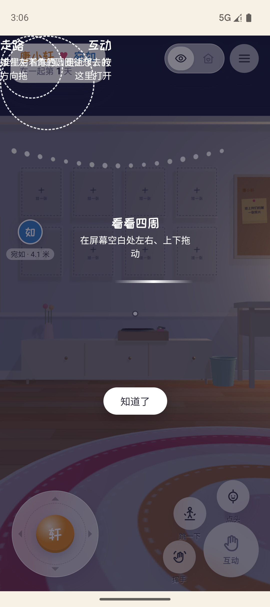

# 小人视角验收记录

日期：2026-10-29（Asia/Shanghai）。实现基于 `ui/characters@9f25c05`，验收依据为 [FIRST_PERSON.md](../../FIRST_PERSON.md)。用户已明确本轮“用模拟器先验证”，以下没有把模拟器结果记成真机通过。

## 环境与范围

- Android：现有 `emulator-5554`，Android 16 / API 36，1080×2424；独立签名验收包 `cn.coupleroom.app.preview`，1.1.0/code 3。通过原生触摸注入操作 WebView，未开启应用调试桥、未更改实体键盘/输入法设置。原正式包未运行或清除。
- 双客户端：两个独立 Chrome/WebGL 上下文、两个测试账号，运行正式网页源码并使用真实 PocketBase SSE。另用单个浏览器客户端向 Android 验收包发送动作和戳一戳，截图来自真实 WebView。
- 后端：阿里云独立 `couple-room-fp-candidate`，独立数据库与测试账号，地址为 `https://api.xn--zbs33ddmy9oeqa.club/couple-room/validation/first-person`。未读写生产房间数据；原服务健康检查正常。
- 凭据、签名私钥、原始 UI 登录转储和测试数据不提交。本文所附截图只使用测试房间。

## 按需求验收

| FIRST_PERSON.md 验收项 | 本轮结果与证据 |
|---|---|
| 登录飞入眼睛、移动、家具碰撞和沿边滑动 | 模拟器真实触控登录并进入第一人称；摇杆移动约 4.52 单位。柜前停在 `z=-4.04`，未穿入碰撞体。13 项移动测试覆盖全部矩形/圆形家具、边界、滑动和长帧防穿透。 |
| 近处照片发亮、打开原面板；远处不可交互 | 模拟器拖动转头、近照片出现目标名与高亮、打开原照片面板；出生点远距互动未打开面板。双客户端脚本同时校验 2.5 距离、原面板阻止移动、多指拖看不误触。 |
| 对方移动平滑、下线坐沙发 | 真实双客户端移动接收通过；0.4 秒插值、走路停止和离线坐沙发通过。同步测试覆盖 1 Hz 限频、停步立即发送、乱序、断线和时钟偏差。 |
| 走近转头、戳一戳在对端提示 | 双客户端校验双方转头、挥手仅播放一次、心情同步、UI 戳一戳与相同话语。浏览器→Android 验收包真实截图显示“宛如 戳了你一下”与屏边闪光；模拟器三个表情按钮均产生对应服务端事件。 |
| 切换视角、重新打开保持 | 模拟器切换俯瞰并强制停止后重启，保持俯瞰；双客户端覆盖刷新后偏好和不重放旧事件。 |
| 中低端 Android 目标 30 FPS | **未验收**：现有环境只有模拟器与桌面 GPU。桌面 Chrome 约 59–60 FPS，仅作开发观察，不能替代中低端真机结果。低配置触屏分支已使用现有 `outline: false`。 |

补充：按住摇杆时将验收包送入后台，位置没有继续变化，presence 立即变为离线；回前台保持停止。菜单清除被按住的 WASD、原面板关闭后恢复控制均通过。真实触感、两台实体手机联调和中低端机性能仍待实际设备复核。

## 可复核报告

- [移动测试：13 项](motion-tests.json)、[同步测试：23 项](sync-tests.json)，合计 36/36。
- [真实双浏览器回归](browser-e2e.json)、[Android 原生触控验收](android-qa.json)。
- [正式 APK 核对](apk-production.json)、[验收 APK 核对](apk-preview.json)：两包均签名有效、19 个网页资产与最终源码一致，两个 preview HTML 均被排除；三个受保护 UI 文件与 `ui/characters` 字节一致。正式包恢复生产地址，只导出、未安装或发布到生产。
- 执行方式及完整 state / wire 字段见 [FIRST_PERSON_IMPLEMENTATION.md](../../FIRST_PERSON_IMPLEMENTATION.md)。

Android 报告的 `evidence` 保留原始本机文件名，完整原始记录位于被忽略的 `android/artifacts/first-person/`；以下五张精选截图已复制并重命名，供仓库内复核。

## 截图

Android 第一人称：

近处照片目标名与互动按钮：

另一客户端发送后，Android WebView 实际收到的戳一戳提示（原始帧时间戳 `1793215257259`）：

强制停止后重新打开，仍保持俯瞰：

## 交给 Claude 的界面修正

新手引导“走路”和“互动”说明重叠在左上角，“知道了”仍能操作。`fp-ui.css:3` 把 `--gap`、`--gapr`、`--bot` 定义在 `.fp`，而 `.fp-tut` 是 `body` 下的同级节点，`fp-ui.css:98–103` 使用变量时缺少继承值。请给教程提供同一变量作用域或回退值。

本轮依照用户分工保留 `web/js/characters.js`、`web/js/fp-ui.js`、`web/css/fp-ui.css` 原样，没有通过其他文件改外观，也没有新增界面事件。此项仍待 Claude 修正。

