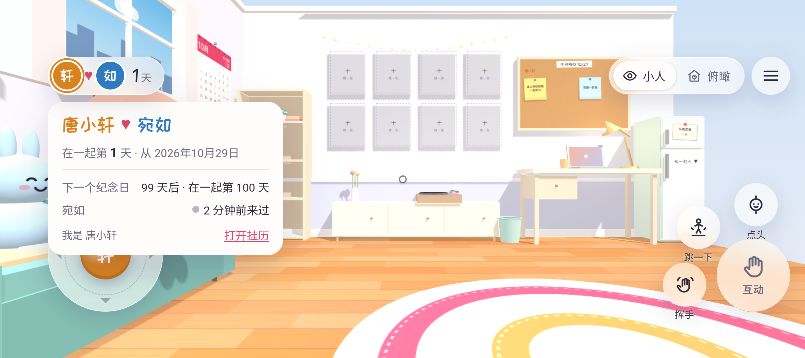
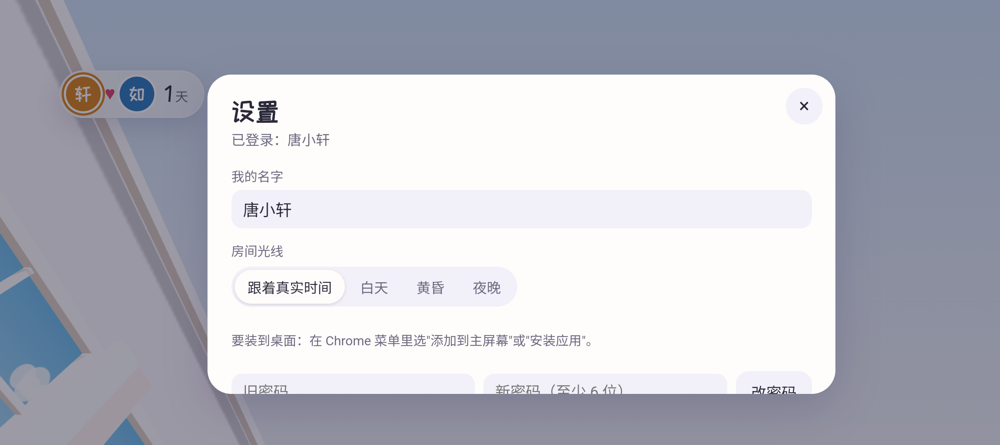
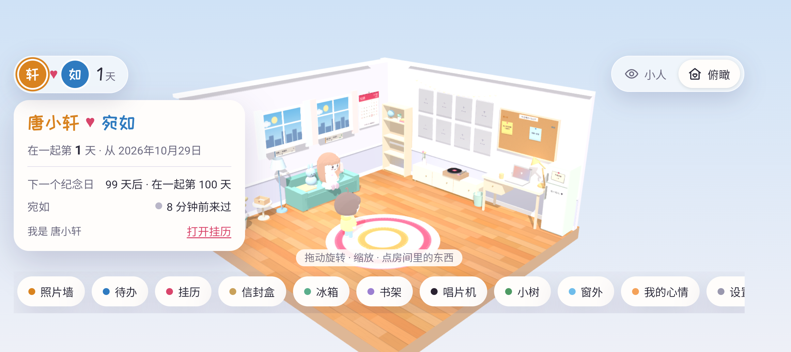
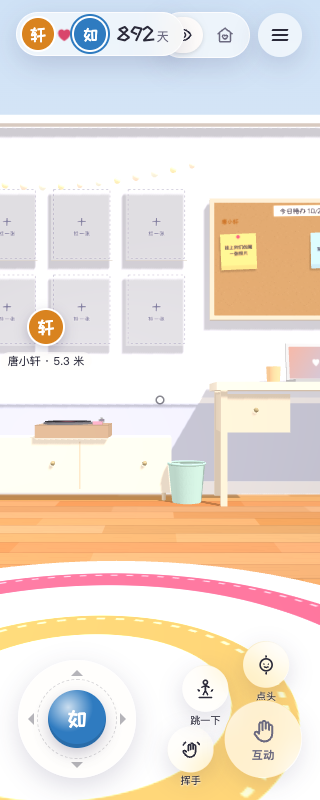

# 合入胶囊 HUD · 4619e32

2026-10-29，按用户要求将 `ui/characters@4619e32cc3f4254b721525920df54ae8a8486513` 合入 `feat/first-person-interactions`，说明见 [HUD.md](../../HUD.md)。

## 合并与保留

- `renderHud`、`openSettings` 两个函数与 UI 提交逐字一致；`room.css`、`fp-ui.css`、`fp-ui.js` 和角色造型源文件也与该 UI 提交一致。[核对报告](upstream-check.json)。
- 冲突仅位于状态初始化：采用 UI 的本机 `room-time-mode` 恢复逻辑，同时保留 `positions`、`presence`、`gestures`、`profileEdits` 初始化。本人行所有权、同步协议、旧玩偶、新小人、两种视角及原面板均保留。
- `.hud` 仍是透明、零 padding 容器；本机安全区适配只覆盖坐标和可用宽度，没有重新给它加卡片背景。
- UI 引入的 `room-time-mode`、`room-hint-visits` 为本机偏好；本次未新增共享 state 或后端 JSON 字段。

## 两处最小兼容修正

1. `mountHud` 按下时仅续 6 秒定时器，不在 pointerdown 重建按钮；外点收起改在 click 冒泡后处理，并用事件路径判断是否点在 HUD 内。否则“打开挂历”或底部快捷按钮会在 click 前被替换，导致点不开。两权威函数本身未改。
2. controller 清理按键/摇杆后重读既有 `getMove()`，让 FPUI 自己清除 `fp-moving`。否则按住移动切到俯瞰后，胶囊可能永久半透明、详情被 CSS 隐藏。未新增按钮或 FPUI 事件。

对应失败复现：[点击被打断](hud-click-before.json)、[走动状态残留](hud-fade-before.json)。修正后实际输入回归通过。

## 验证

- 36 项移动/同步测试通过；[14 项双客户端原交互回归](browser-e2e.json)通过。
- [20 项 HUD/视口检查](hud-viewport.json)通过：胶囊44px、展开/6秒/触屏外点收起、打开挂历、详情展开时直接点底栏、走动切俯瞰的透明度复原、设置光线及重启偏好、左右刘海/短横屏/竖屏布局与原面板。
- [Android 原生触控快验：8/8](android-qa.json)：胶囊、挂历入口、夜晚重启保留、恢复自动、真实摇杆走动后切俯瞰和左右横屏通过。原生测试为松开摇杆再点俯瞰；按住键盘移动直接切俯瞰的边界由浏览器专项覆盖。只运行独立验收包，保留生产 app、原旋转与键盘设置；不视作真机验收。
- Android release 构建/lint 成功；[普通构建核对](apk-production.json)、[验收构建核对](apk-preview.json)均签名有效、20 个网页资产与源码一致、两演示页排除。此轮为合并验证构建，未覆盖 `android/releases/` 中上一轮导出的 1.1.2 文件。

安卓实际胶囊/详情：

设置里的房间光线：

反向横屏：

## 交给 Claude 的窄屏观察

320px CSS 宽度、显示三位数“892天”时，胶囊和右上角控件仍有约25.7px横向重叠。报告将其单独列为观察项，没有记作通过；393px、左右852px横屏与640px短横屏检查通过。

保留 UI 造型源文件原样，请由 Claude 调整窄屏布局。此截图仅替换测试页面显示的天数字符来检查排版，没有修改共享开始日期或后端数据。

## 后续 APK 导出

按用户后续要求，胶囊 HUD 版本已导出为正式签名的 1.1.3/code 6，沿用原包名和签名，可覆盖安装。[最终 APK 核对](../apk-exports/1.1.3.json)；本次只升级版本元数据，运行逻辑与上述已验证合并一致。
