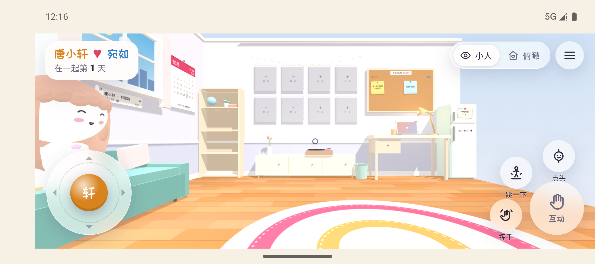
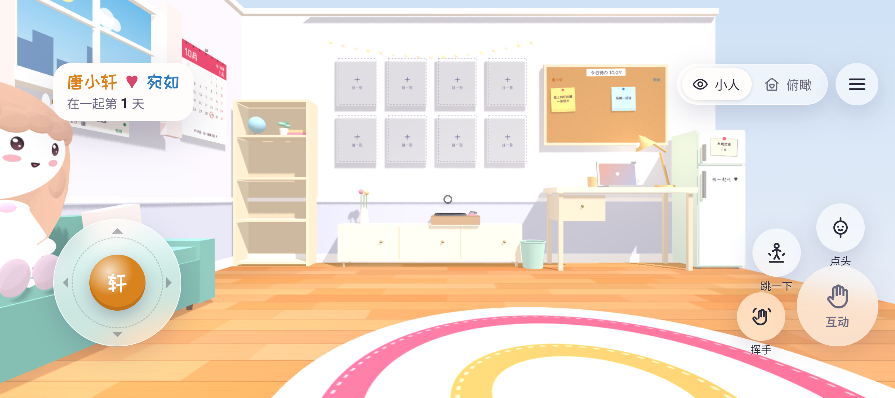
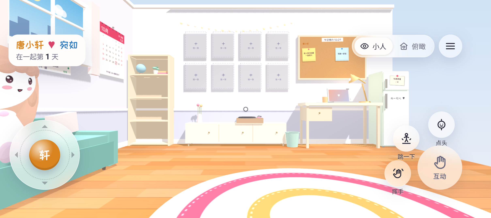
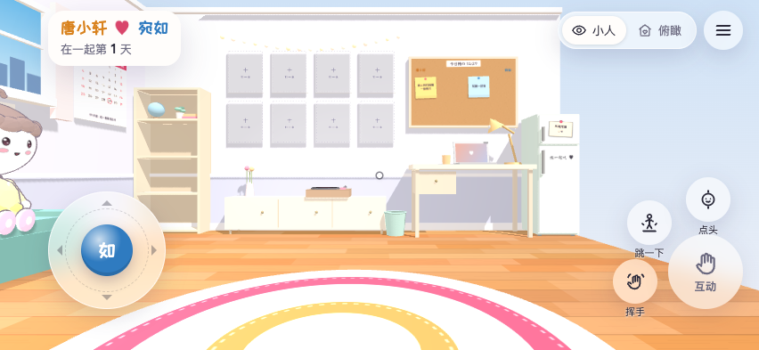

# 1.1.1 横屏边缘适配

日期：2026-10-29（Asia/Shanghai）。用户报告横屏存在大块黑边和白边。本轮沿用现有角色和按钮，没有修改 `web/js/characters.js`、`web/js/fp-ui.js`、`web/css/fp-ui.css`。

## 根因与改动

旧 Android 外壳将 `systemBars | displayCutout | ime` 一起作为整个 WebView 的 padding，又原样传给 WebView。模拟器横屏窗口为 2424×1080，真实 native WebView 只有 `(142,137)–(2424,1017)`：左侧挖孔预留 142px、顶部状态栏 137px、底部导航栏 63px，因此背景带露在房间外侧。网页 `#stage` 本身已经是 `fixed; inset:0`。

- 使用沉浸窗口及 cutout 绘制，房间和准星铺满整个窗口；系统栏可通过屏幕边缘滑动临时唤出。
- 原生仅处理键盘的占用高度，并向 WebView 下发零 IME inset，避免旧/新 WebView 重复缩小或收起后留下空白。
- `viewport.css` 使现有控件、对方方位、登录与原面板避开刘海和手势区域。原生传入 `--android-safe-top/right/bottom/left`，单位为 CSS px；和 `env(safe-area-inset-*)` 取最大值，避免重复留距。此适配也用于不支持 CSS inset 的现有 WebView 133。
- 旋转/重新获得窗口焦点后恢复全屏，页面加载完成后重新下发四边安全区；实际 stage 尺寸的 ResizeObserver 更新画布和相机，不重置人物身份、位置、朝向或视角偏好。
- APK 版本 1.1.1/code 4，沿用原签名，20 个网页资产与最终源码一致；两个演示 HTML 仍从 APK 排除。state、后端 JSON 和同步协议没有新增字段；四个 CSS 变量仅为本地宿主布局数据。

## 验证结果

| 场景 | 已执行结果 |
|---|---|
| 横屏 90°，左挖孔 | 实际 WebView 为 `(0,0)–(2424,1080)`，画面铺满，左侧控件避开挖孔 |
| 横屏 270°，右挖孔 | 实际 WebView 为 `(0,0)–(2424,1080)`，右侧控件移入安全区 |
| 回竖屏 | 实际 WebView 为 `(0,0)–(1080,2424)`，顶部控件避开挖孔 |
| 原面板、键盘与 Back | 待办面板可用；现有键盘在横屏报告 231px 高度时，WebView 仅缩为 849px（1080−231），收起后恢复 1080px，无残留背景带；输入文字未提交 |
| 宛如账号布局 | 393×852、852×393 左右刘海、640×320 短横屏、回竖屏共 17 项检查通过；覆盖画布与准星、按钮/文字/方位安全区、原面板关闭和末尾控件、身份/位置/视角保持 |
| 原交互回归 | 36 项移动/同步测试和 12 项真实双客户端回归通过 |
| 打包 | 正式与独立验收包均通过签名和 20 资产核对；release lint 为 0 errors、10 warnings |

复用现有 Android 16/API 36 模拟器和隔离验收后端，只安装/运行 `cn.coupleroom.app.preview`；原正式 app 未改，键盘、输入法、实体键盘及按键捕获设置未改。正式 APK 仅导出，未发布或安装到生产账号。没有真机结果或低端手机性能结论。

## 证据与复跑

- [原生横屏/键盘报告](android-landscape-qa.json)
- [布局专项报告](browser-viewport.json)；[旧 CSS 负控](browser-viewport-before.json)：旧版未处理原生 safe-top 时检查失败，新版通过。
- [两客户端回归](browser-e2e.json)
- [正式 APK 核对](apk-production.json)、[验收 APK 核对](apk-preview.json)
- 专项脚本：`npm run test:viewport`；需要 Chrome 和本机受保护的隔离环境凭据，详见 [实现说明](../../FIRST_PERSON_IMPLEMENTATION.md)。完整原始 UI/窗口记录保留在被忽略的 `android/artifacts/landscape/`，本文只收录测试房间截图。
- Android 行为依据：[沉浸模式](https://developer.android.com/develop/ui/views/layout/immersive)、[WebView inset 的版本支持与避免重复留距](https://developer.android.com/develop/ui/views/layout/webapps/understand-window-insets)。

修改前：

修改后，左侧挖孔：

修改后，右侧挖孔：

宛如账号的横屏布局检查：

