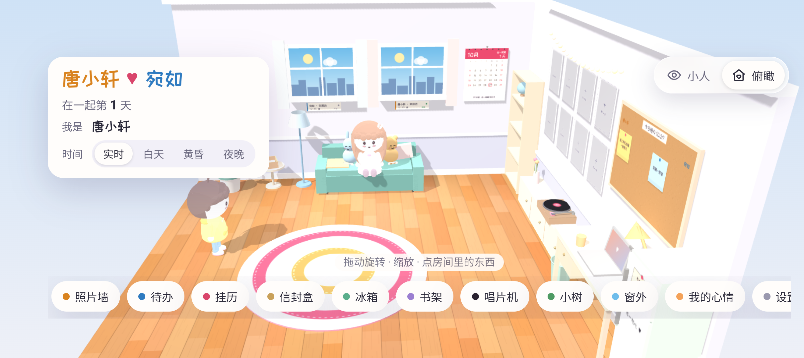
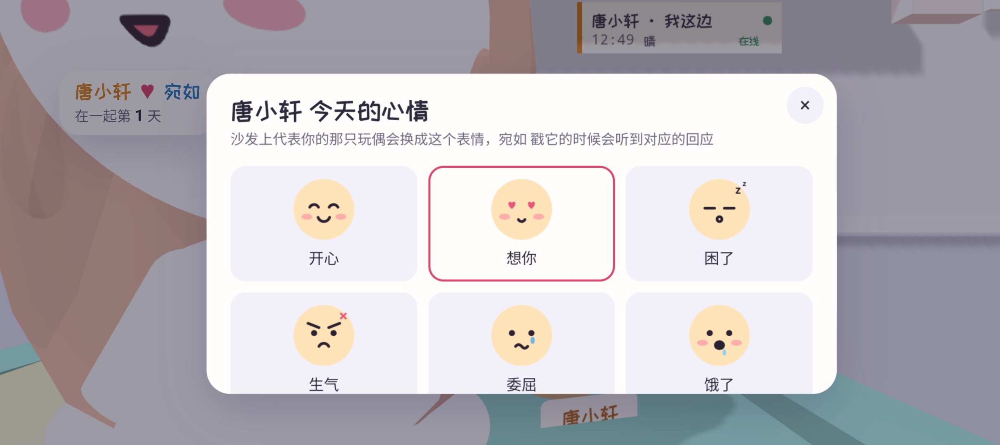
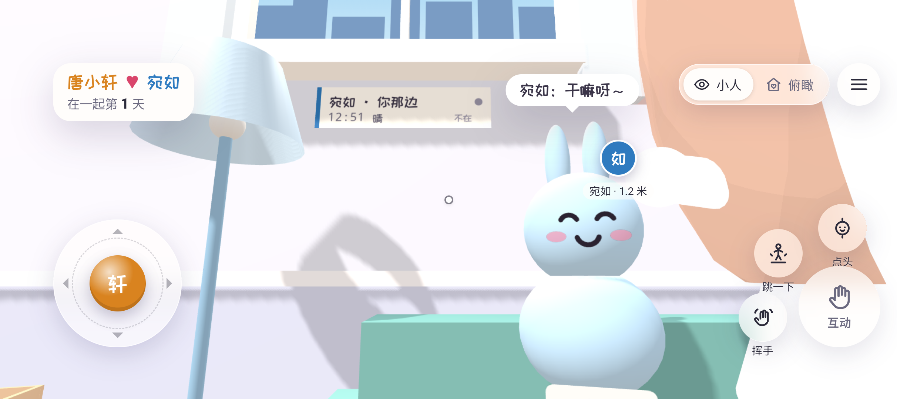
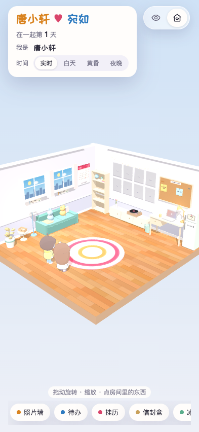
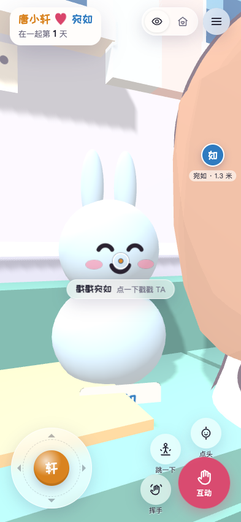
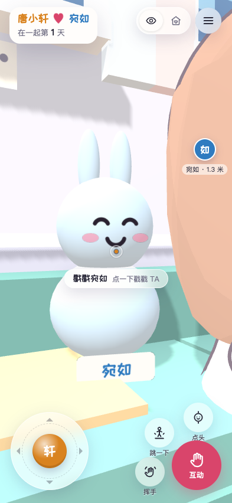

# 1.1.2 原沙发玩偶恢复

日期：2026-10-29（Asia/Shanghai）。用户要求恢复原来沙发上的小熊与小兔，同时保留小人视角，重新导出 APK。

## 结果

- 原橙色小熊和蓝色小兔恢复显示及点击，两种视角都保留；原尺寸、朝向和沙发位置不变。世界坐标分别为 `(-4.3,.76,-.87)` 与 `(-4.3,.76,.30)`。
- 点击自己的原玩偶仍打开心情面板，同时更新玩偶和新小人的表情；点击对方原玩偶仍弹跳并在玩偶上方冒气泡，对端继续收到原有的戳一戳通知。
- 新小人的移动、碰撞、位置/表情/动作同步、第一人称隐藏自身、俯瞰显示自身均保留。离线对方坐在沙发中间前缘 `(-3.75,.36,-.25)`，避开两只原玩偶；此位置仅用于本机展示，不写回对方的同步位置。
- 两种视角的点击统一通过 controller 的同步 `activate(owner)` 路径，临时保留点击来源并在 `finally` 清理；让玩偶与小人的气泡各自锚定实际对象。App、Sync、后端 JSON 和共享 state 字段没有变化。没有新增 FPUI 按钮或事件。
- 横竖屏铺满、安全区和键盘适配继续保留；三个受保护的 UI/造型文件与 `ui/characters` 字节一致。
- 正式 APK 为 1.1.2/code 5，包名与原签名不变；独立验收包为 `cn.coupleroom.app.preview`。两包均校验 20 个网页资产，排除两张预览 HTML。

## 检查与证据

- 36 项移动/同步测试通过。
- [14 项真实双客户端回归](browser-e2e.json)通过，新增：两玩偶在两种视角可见并保持原位置；实际走近后，通过现成按钮点自己的玩偶改心情，再点对方玩偶验证弹跳、原气泡与远端通知。原小人戳一戳、挥手、离线坐姿、照片面板等继续通过。
- [Android 模拟器验收：7/7](android-qa.json)。实际触控验证俯瞰中四个对象共存、FP走近原玩偶、自己玩偶的心情面板、对方玩偶弹跳气泡和两侧横屏/回竖屏。只使用已有模拟器和隔离验收包，不更改生产 App、键盘/输入法设置；不将结果表述为真机验收。
- [正式 APK](apk-production.json)、[独立验收 APK](apk-preview.json)的版本、签名、源资产一致性与预览页排除核对。
- 复跑：`npm test`、`npm run test:browser`；构建及私密凭据引用见 [实现说明](../../FIRST_PERSON_IMPLEMENTATION.md)。完整本机记录位于被忽略的 `android/artifacts/mascot-restore/` 与 `android/artifacts/first-person/`。

模拟器中原小熊、小兔与两位新角色同时保留：

实际点自己的小熊打开心情面板：

实际点对方小兔后的跳动与气泡：

部分俯瞰斜角会有前排小人发丝对玩偶边缘的正常视线遮挡；旋转到正面或走近可看清。原玩偶不随第一人称模式或在线状态隐藏。

双客户端脚本的俯瞰画面：

第一人称走近后，可点击原小兔：

点原玩偶后，气泡仍出现在原玩偶上方：

